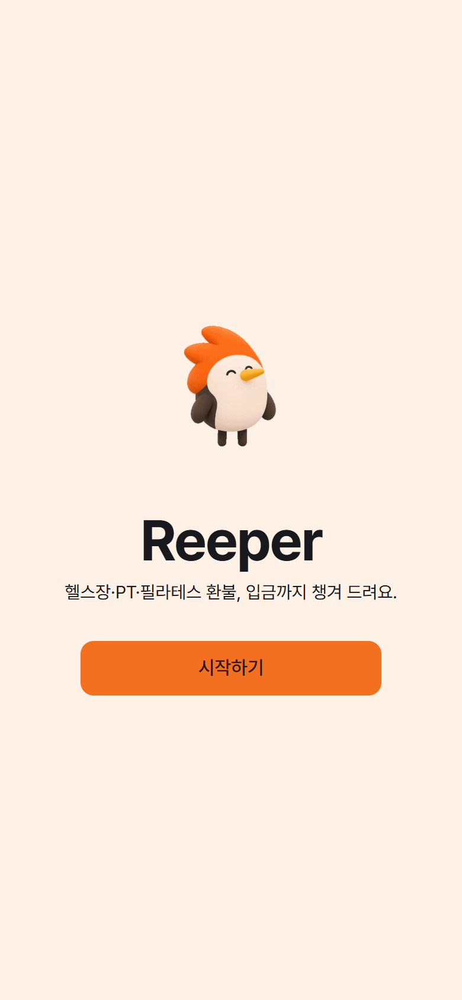
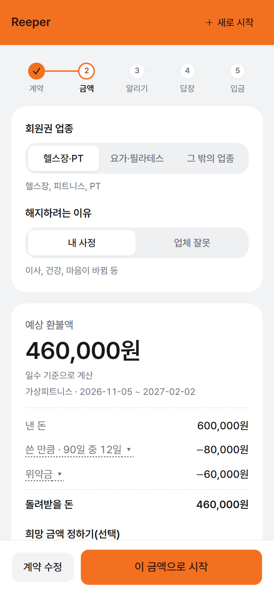
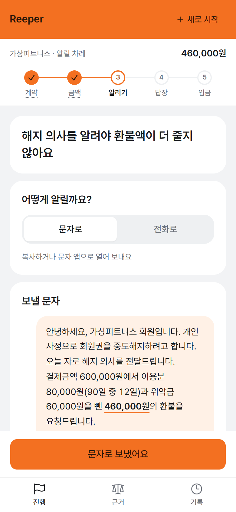
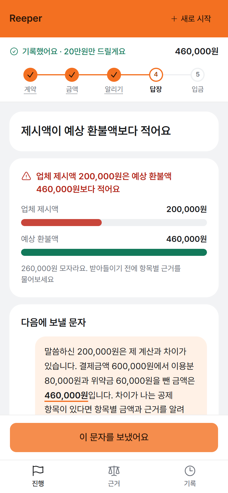
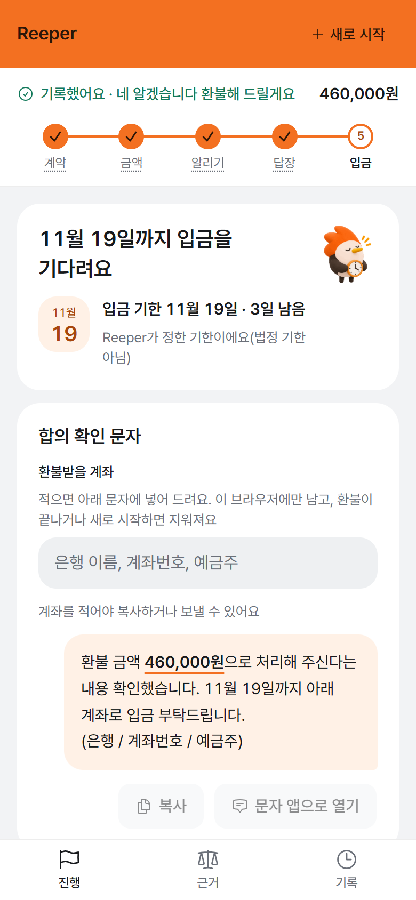
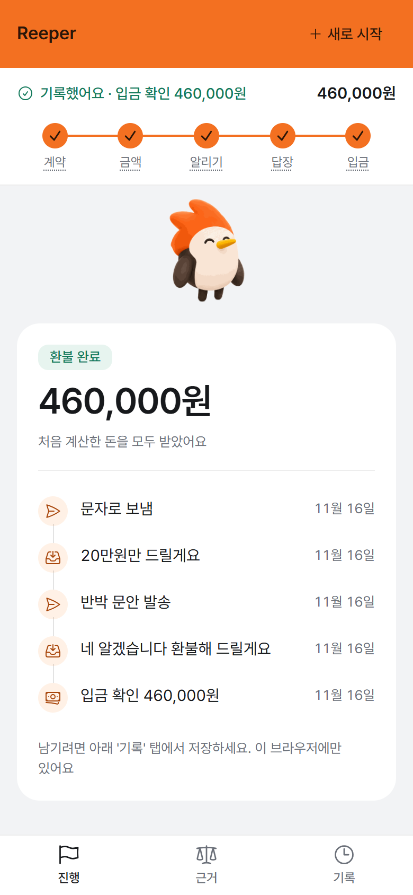
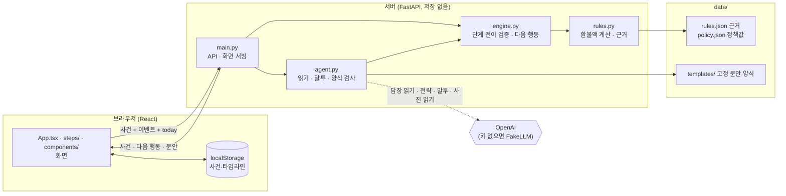
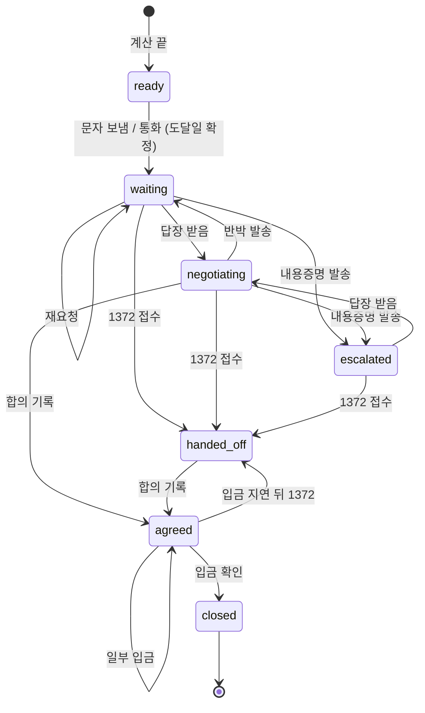

# Reeper

Refund-keeper. 헬스장·PT·필라테스를 중도해지하려는 청년의 환불을, 말 꺼내기부터 입금까지 챙겨 주는 AI 에이전트다.

> **근거를 다 찾아 두고, 그대로 보내거나 말할 문장을 만들어 주고, 환불금이 계좌에 들어올 때까지 추적한다.**

2026 대한민국 청년 CAREER FAIR AI 해커톤 출품작이며, 제출 마감은 2026-11-23 17:00이다. 공개 주소는 https://reeper-9jp2.onrender.com 이다(비용 때문에 AI 없이 낱말 판정으로 돈다. [소개서](docs/소개서/소개서.md) 참고).

## 풀려는 문제

**미룰수록 환불액이 줄어드는데, 근거와 기한을 끝까지 챙겨 줄 사람이 없다.**

- 공정위 고시의 공제 기준은 **해지 의사가 업체에 닿은 날**이다. 한 번도 가지 않았어도 개시일 이후 지난 날짜는 이용한 것으로 본다. 전화가 부담돼 며칠 미루면 그만큼 돈이 줄어든다.
- 전화와 불편한 말이 어려운 사람은 **무슨 말을, 어떤 순서로, 어떤 근거로** 해야 하는지부터 막힌다.
- 업체가 답을 안 하거나 "방문해서 얘기하자", "정상가로 계산해야 한다"로 돌리면 **대부분 거기서 멈춘다.** 다음에 무엇을 해야 하는지, 어디까지 하면 되는지 모른다.
- 겨우 합의해도 **입금 확인과 독촉을 끝까지 챙기는 사람이 없다.**

### Reeper가 푸는 방법

| 막히는 곳 | Reeper가 하는 일 | 하지 않는 일 |
|---|---|---|
| 얼마를 요구해야 할지 모른다 | 결제액·기간·이용일로 예상 환불액을 **코드가** 계산하고, 하루 늦을 때 줄어드는 금액을 보여 준다 | LLM이 금액을 만들지 않는다 |
| 며칠 미루다 돈이 준다 | 도달일을 기록하고 답장 기한과 입금 기한을 센다 | 법정 기한처럼 보이게 하지 않는다 |
| 무슨 말을 해야 할지 모른다 | 보낼 문자와 통화 대본(첫마디, 꼭 말할 것, 반론별 대답)을 **고정 양식**으로 채워 준다 | 전화하거나 문자를 대신 보내거나 통화를 듣지 않는다. 보내고 말하는 것은 사용자다 |
| 업체 답을 읽을 줄 모른다 | 붙여넣은 답장을 읽어 유형·금액을 보여 주고, **사용자가 확정해야** 기록한다 | 자동 판단만으로 합의를 기록하지 않는다 |
| 낮은 금액을 받아들일까 고민한다 | 제시액을 예상 환불액·내 최저 수용선과 견줘 "받아들이기 전에 항목별 근거를 물어보라"고 안내한다 | 법적 판단을 확정하지 않는다 |
| 거절당하면 끝이라고 생각한다 | 재요청 → 내용증명 → 1372로 이어지는 **다음 행동**을 단계마다 알려 준다 | 소송·고소를 권하지 않는다 |
| 업체 잘못인지 헷갈린다 | 해지 이유가 업체 잘못이면 유형을 고르게 하고, 그 사유가 인정된다는 조건으로 예상 환불액(업체가 다툴 때의 금액도 함께)을 보여 준다. 업체가 받아들이지 않으면 1372에 말할 사실을 정리해 준다 | 업체 잘못의 금액을 단정하지 않는다 |
| 합의 뒤 흐지부지된다 | 합의 문자, 입금 기한(주말 뺀 3영업일), 일부 입금, 독촉 문안까지 추적해 입금이 확인돼야 종결한다 | |

> 환불 계산은 **일반적인 기준 안내**다. 고시·법 원문과 대조했지만 해지 통보가 닿은 날의 포함 여부와 원 단위 끝전은 아직 확인 중이며 화면에도 그렇게 표시한다. 근거는 `data/rules.json`에 있는 것만 쓴다. 자세한 기준은 [환불 규칙](docs/환불_규칙.md).

## 화면

가상 계약서(가상피트니스, 결제 60만원, 90일 중 12일 이용)로 시작부터 입금 확인까지 간 모습이다. 모바일 화면을 기준으로 만들었다.

| 시작 | 금액 | 알리기 |
|:---:|:---:|:---:|
|  |  |  |
| **답장** | **입금** | **완료** |
|  |  |  |

1. **금액**: 예상 환불액과 계산 내역을 먼저 보여 준다.
2. **알리기**: "해지 의사를 알려야 환불액이 더 줄지 않아요"에 맞춰 문자나 통화 대본을 고른다. 알리기 전에 날짜가 지나면 예상 환불액을 그날 기준으로 다시 계산해 줄어든 만큼 알려 준다.
3. **답장**: 제시액이 예상 환불액보다 적으면 차이와 반박 문안을 보여 준다.
4. **입금**: 입금 기한과 합의 확인 문자를 준다.
5. **완료**: 입금을 확인하면 타임라인과 함께 종결한다.

화면은 위 막대(계약·금액·알리기·답장·입금)와 아래 탭(진행·근거·기록)으로 이뤄진다. 시연용 조작(업체 답장, 날짜 건너뛰기)은 주소 끝에 `?demo`를 붙일 때만 보인다.

## 현재 상태

가짜 LLM으로 접수 → 환불액 → 문자 문안·통화 준비 카드 → 기록 → 업체 반응 대응 → 합의 → 입금 확인까지 간다. 목표 금액과 최저 수용선, 무응답 경로(재요청 → 내용증명 → 1372), 타임라인, 사건 파일 내보내기가 화면에 있다.

- 접수 때 해지 이유(내 사정, 업체 잘못)를 묻는다. 업체 잘못이면 유형을 고르게 하고, 그 사유가 인정된다는 조건으로 위약금 0원의 예상 환불액과 업체가 다툴 때의 금액을 함께 보여 준다. 문자·통화로 협상하고 반박 한 번 뒤에도 거절하면 내용증명 없이 1372로 넘어간다.
- 반박을 두 번 보냈는데도 업체가 받아들이지 않으면 내용증명, 그다음 1372로 넘어간다. 업체 잘못 해지는 반박 한 번 뒤 바로 1372다.
- 실제 LLM(OpenAI)은 답장 읽기, 전략, 말투 다듬기, 계약서 사진 읽기에 연결돼 있다. 2026-11-15~22에 실제 모델로 평가를 돌렸다([평가 결과](docs/평가_결과.md), [실행 기록](eval/README.md)).
- 키가 없거나 하루 호출 상한을 넘으면 자동 기능을 끄고 고정 양식과 버튼으로 끝까지 간다.
- 계약서 사진 읽기는 `ALLOW_UPLOAD=1`일 때만 켜지고, 합성(가상) 계약서로만 쓴다.
- 배포처는 Render 무료와 Cloudflare Containers 두 곳을 준비했다([배포](docs/배포.md)).
- 위약금 10% 상한은 고시 별표의 헬스·피트니스업, 요가·필라테스업 기준이다.

## 실행

Python 3.13 이상과 Node 22 이상이 필요하다.

```bash
# 서버
cd backend
python -m venv .venv
.venv/Scripts/python -m pip install -r requirements.txt   # macOS·Linux는 .venv/bin/python
.venv/Scripts/python -m uvicorn app.main:app --reload --port 8000 --env-file .env   # .env가 없으면 --env-file을 뺀다

# 화면 (다른 터미널)
cd frontend
npm install
npm run dev        # http://localhost:5173, /api는 8000번으로 넘어간다
```

실제 LLM은 `backend/.env.example`을 `backend/.env`로 복사해 키를 넣으면 켜진다. 없으면 가짜 LLM으로 돈다. `.env`는 저장소에 올라가지 않는다.

| 환경변수 | 기본값 | 뜻 |
|---|---|---|
| `OPENAI_API_KEY` | 없음 | 있으면 실제 LLM을 쓴다 |
| `OPENAI_MODEL` | `gpt-6.1-terra` | 모델명 |
| `LLM_DAILY_LIMIT` | 300 | 하루 전체 호출 상한. 넘으면 고정 양식과 키워드 판단으로 계속 간다 |
| `ALLOW_UPLOAD` | 꺼짐 | `1`이면 계약서 사진 읽기를 켠다 |

`GET /api/health`에서 쓰는 구현, 남은 호출 수, 오늘 쓴 토큰을 본다.

테스트는 키 없이 돈다.

```bash
cd backend && .venv/Scripts/python -m pytest -q
cd frontend && npm run build
```

배포 형태로 확인하려면 `npm run build` 뒤 서버만 띄우고 `http://localhost:8000`을 연다. 서버가 `frontend/dist`를 함께 내보낸다. 컨테이너는 `docker build -t reeper . && docker run -p 8000:8000 reeper`.

## 구조

### 시스템

사건은 브라우저에만 있고, 서버는 받은 사건에 규칙을 적용해 돌려준다. 서버에는 아무것도 저장하지 않는다.



- **금액과 단계는 코드가 정한다.** LLM은 읽고(답장·사진), 다듬고(말투), 전략을 쓸 뿐 숫자와 단계를 바꾸지 못한다. 문안 속 금액과 조문은 `validate`를 통과해야 한다.
- LLM이 실패하거나 하루 상한을 넘으면 `FakeLLM`과 고정 양식으로 계속 간다.

### 사건 단계

단계 전이는 `engine.py`가 검증하고, 허용되지 않은 전이는 409로 막는다.



| 단계 | 뜻 |
|---|---|
| `ready` | 계산이 끝났고 아직 알리지 않았다 |
| `waiting` | 알렸고 답을 기다린다 |
| `negotiating` | 답을 받았고 대응이 필요하다 |
| `escalated` | 내용증명을 보냈다 |
| `agreed` | 합의했고 입금을 기다린다 |
| `closed` | 입금을 확인했다 |
| `handed_off` | 1372 소비자상담센터에 접수했다 |

### 폴더

```
backend/app/
  models.py   공유 계약: Contract, Refund, Case, Event, Action
  rules.py    환불 계산, 근거 표와 정책값 읽기
  engine.py   단계 전이: open_case, apply, next_action
  agent.py    LLM이 맡는 일(OpenAI, 키가 없으면 FakeLLM), 문안 양식 채우기와 검사
  main.py     API와 화면 서빙
backend/tests/  키 없이 도는 테스트
frontend/src/   App.tsx(화면), steps/(여정 단계별 화면), components/, ui/(공용 부품), api.ts(서버 계약 사본)
data/           rules.json(근거), policy.json(정책값), templates/(문안 양식), samples/(가상 계약서)
eval/           평가셋과 평가 스크립트(run.py), 실행 기록
harness/        사건 경로와 화면 흐름 자동 점검
docs/           기획안, 개발 계획, 계약, 환불 규칙, 배포, 브랜치 규칙
```

## 설계 원칙

- **계산은 코드, 읽기는 AI, 보내고 말하는 것은 사람.** 에이전트는 전화하지 않고, 문자를 보내지 않고, 통화를 듣지 않는다.
- **서버는 사건을 저장하지 않는다.** 사건은 브라우저에만 보관하고, 서버는 받은 사건에 규칙을 적용해 돌려준다.
- **금액은 코드가 계산한다.** 문안 속 금액과 조문은 검사를 통과해야 한다.
- **근거는 `data/rules.json`에 있는 것만 쓴다.**
- **법적 판단을 확정하지 않는다.** "일반적인 기준 안내"로 표시하고 1372 소비자상담센터로 연결한다.
- **가상 데이터만 쓴다.** 실제 계약서, 개인정보, API 키를 저장소에 넣지 않는다.

## 문서

- [기획안](docs/기획안.md): 목표, 문제 정의, 사건 흐름, 안전장치, 평가 계획.
- [개발 계획](docs/개발_계획.md): 범위, 개발 방식, 단계와 통과 조건, 3인 트랙, 우선순위.
- [계약](docs/계약.md): 사건 상태, 이벤트, 행동, API. 바꾸기 전에 다른 트랙과 조율한다.
- [환불 규칙](docs/환불_규칙.md): 법적 근거 표와 확인이 필요한 항목.
- [배포](docs/배포.md): 환경변수, 컨테이너 빌드, 배포 직후 확인.
- [브랜치 규칙](docs/브랜치_규칙.md): 브랜치 이름, PR과 리뷰 순서.
- [평가 결과](docs/평가_결과.md): 보고할 숫자, 읽을 때 주의할 점, 완료 기준 점검.
- [평가 실행 기록](eval/README.md): 평가셋, 실행 방법, 실제 모델 실행 결과.
- [에이전트 작업 규칙](AGENTS.md): AI 코딩 에이전트가 지킬 것.

## Credits / Licenses

「AI 해커톤 AI 활용 및 출처 표기 기준」 제5조의 형식을 따른다. AI와 팀의 역할은 [AI 활용내역](docs/제출_AI활용내역.md)에 있다.

### 오픈소스

| 이름 | 라이선스 | 링크 | 용도 |
|---|---|---|---|
| React 19 | MIT | github.com/facebook/react | 화면 |
| Vite | MIT | github.com/vitejs/vite | 화면 빌드 |
| TypeScript | Apache-2.0 | github.com/microsoft/TypeScript | 화면 |
| Tailwind CSS 4, tw-animate-css | MIT | github.com/tailwindlabs/tailwindcss | 화면 스타일 |
| shadcn/ui | MIT | github.com/shadcn-ui/ui | 화면 부품(코드를 받아 고쳐 씀) |
| Base UI | MIT | github.com/mui/base-ui | 화면 부품의 바탕 |
| class-variance-authority | Apache-2.0 | github.com/joe-bell/cva | 화면 부품 변형 |
| Heroicons | MIT | github.com/tailwindlabs/heroicons | 아이콘 |
| FastAPI, Pydantic | MIT | github.com/fastapi/fastapi, github.com/pydantic/pydantic | 서버 |
| Uvicorn, HTTPX, python-dotenv | BSD-3-Clause | github.com/encode/uvicorn, github.com/encode/httpx, github.com/theskumar/python-dotenv | 서버 실행, OpenAI 호출, 환경변수 |
| pytest, Playwright | MIT, Apache-2.0 | github.com/pytest-dev/pytest, github.com/microsoft/playwright | 테스트, 화면 흐름 점검 |
| matplotlib | Matplotlib License(PSF 기반) | github.com/matplotlib/matplotlib | 소개서 그래프(`docs/소개서/make_charts.py`) |

### 데이터

| 데이터 | 제공기관 | 라이선스·이용 조건 | 기준일 |
|---|---|---|---|
| 방문판매 등에 관한 법률, 「계속거래 등의 해지·해제에 따른 위약금 및 대금의 환급에 관한 산정기준」(공정거래위원회 고시) | 국가법령정보센터(law.go.kr) | 법령·고시는 저작권 보호 대상이 아니다(저작권법 제7조) | 2026-11-18 원문 확인 |
| 헬스·PT·필라테스 분쟁조정·피해구제·상담 사례 | 소비자24(consumer.go.kr), 한국소비자원(kca.go.kr) | 공개 사례를 요약해 쓰고 사례마다 출처 주소를 남겼다(`data/mediation_cases.json`, `eval/case_pool.jsonl`) | 2026-11-21 수집 |
| 헬스장 피해구제·상담 통계, 체육시설업 현황 | 한국소비자원 보도자료, 문화체육관광부 | 출처 표기(`docs/소개서/출처.md`) | 각 자료의 발표일 |
| 평가용 계약서·답장·상황 | 팀 제작(가상 데이터) | 저장소와 같음 | - |

### 이미지·음원·폰트

| 자료 | 제작자·출처 | 라이선스 |
|---|---|---|
| Pretendard | github.com/orioncactus/pretendard | SIL OFL 1.1 |
| Noto Sans KR | Google Fonts | SIL OFL 1.1 (소개서 PDF 글꼴, 저장소 외) |
| 맑은 고딕 | Microsoft (Windows 기본 글꼴) | 소개서 그래프 그림에만 쓰임 |
| 마스코트(딱따구리) 그림 `frontend/src/assets/mascot/` | AI 생성(ChatGPT 웹), A 트랙 | OpenAI 이용약관 |
| 시연 영상 배경음 「Afterglow Circuit」(시연 영상에만, 저장소 외) | AI 생성(OpenAI gpt-6-astra), C 트랙 | OpenAI 이용약관 |

### AI 모델·API

| 이름 | 제공 | 용도 |
|---|---|---|
| gpt-6.1-terra (Chat Completions API) | OpenAI, 이용약관 | 서비스의 답장 읽기·분석, 조언, 말투 다듬기, 계약서 사진 읽기 |
| Claude Code | Anthropic, 이용약관 | 개발(코드·테스트·문서 작성, 리뷰 초안) |
| Codex | OpenAI, 이용약관 | 개발(교차 검증) |
