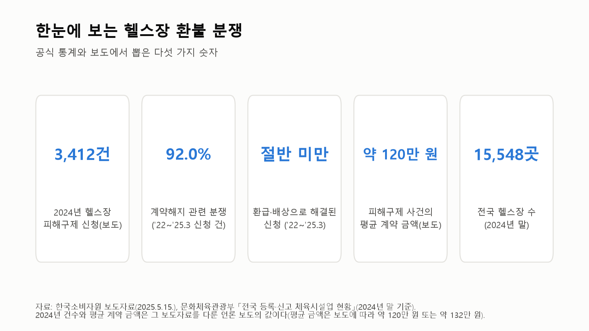
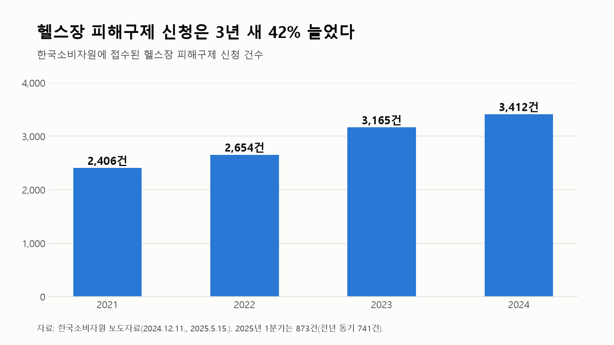
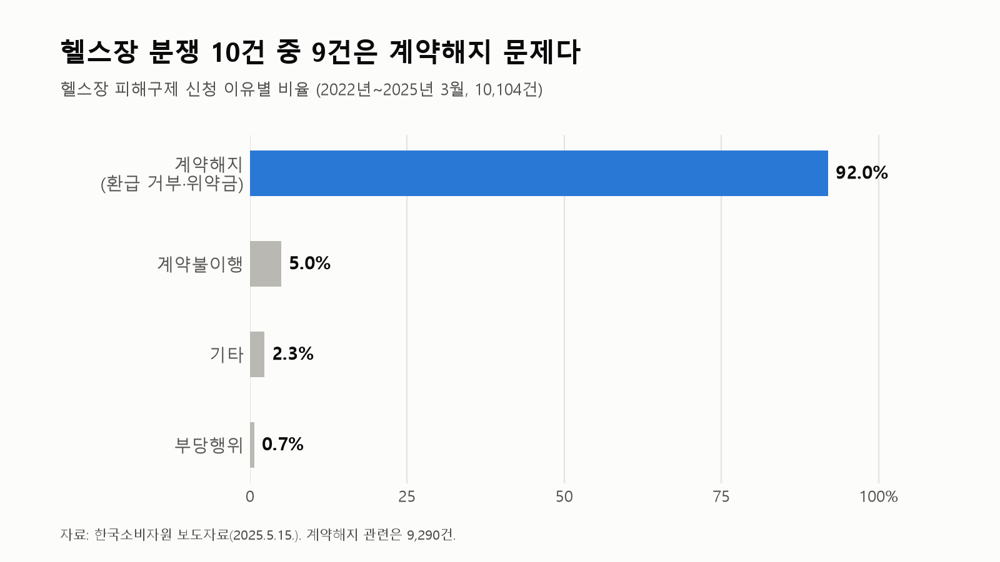
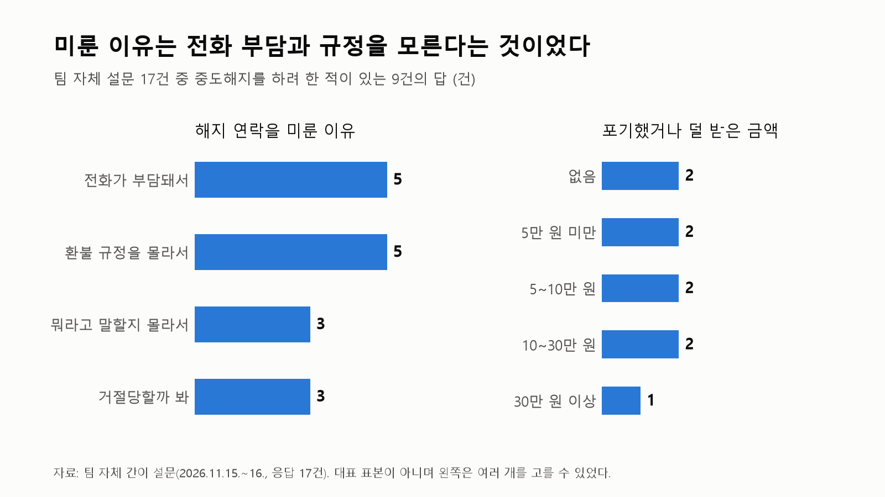
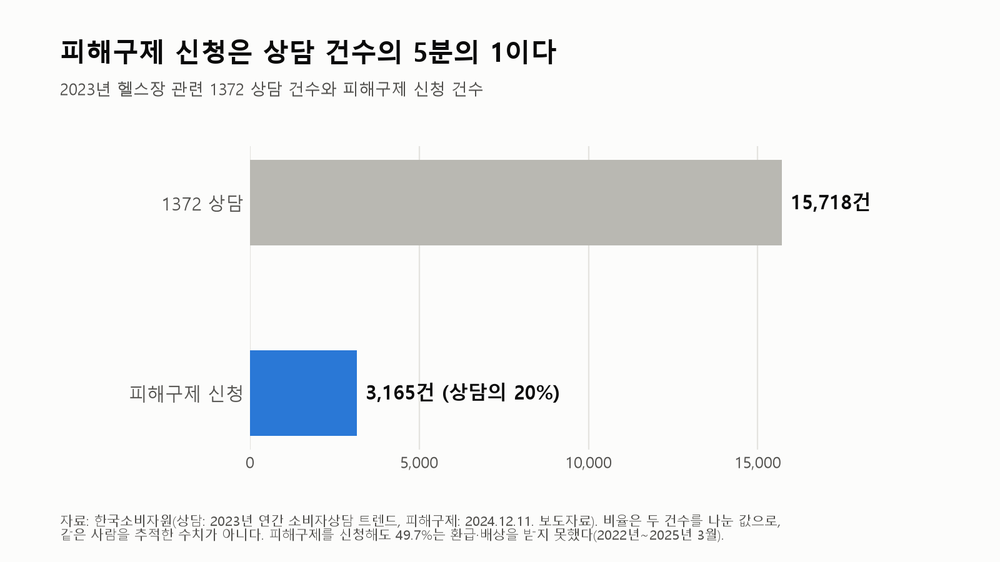
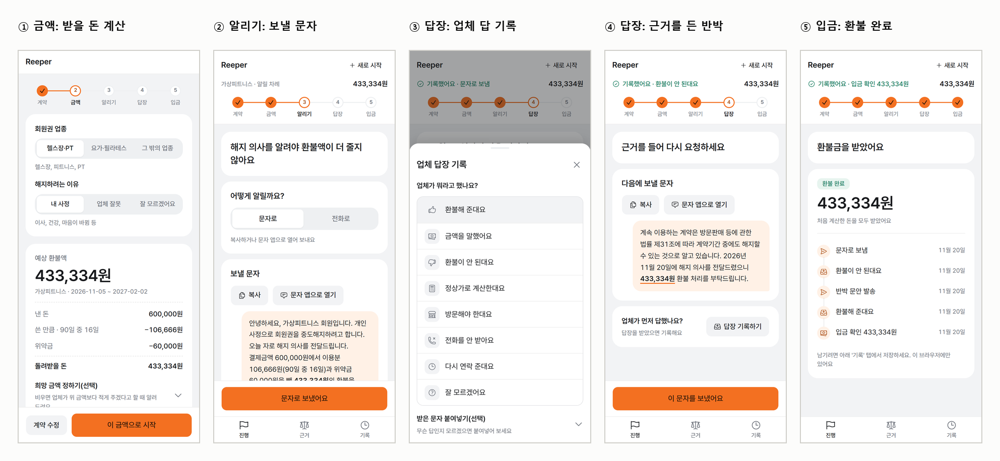
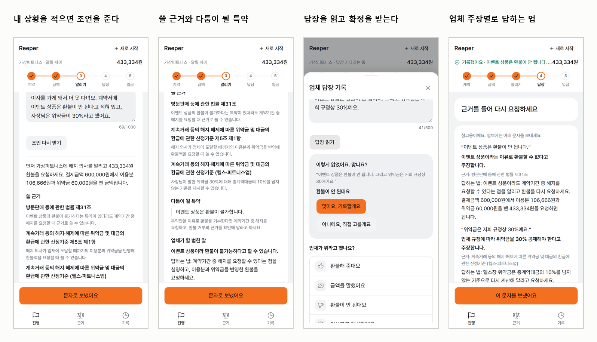
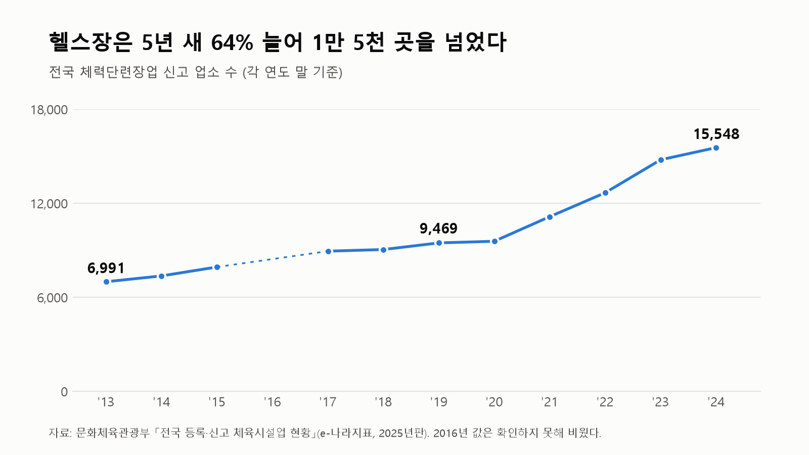
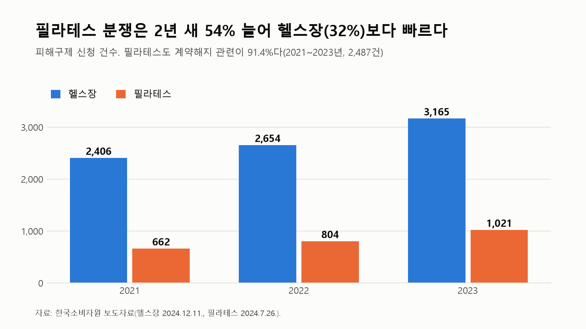

# Reeper 소개서 (초안)

회원권 환불, 말 꺼내기부터 입금까지 챙겨 주는 에이전트

2026-11-20 초안 · 2026 대한민국 청년 CAREER FAIR AI 해커톤

> **읽는 법**: `[확인 필요]`는 원문이나 실행으로 다시 확인해야 하는 자리다. 제출 전에 모두 지운다. `[이름 A]`·`[이름 B]`·`[이름 C]`와 `[심사용 주소]`는 저장소에 적지 않고, 제출용 워드 파일을 만들 때만 채운다(`build_docx.py`).

## 1. 한 줄 소개

Reeper는 헬스장·PT·필라테스 회원권을 중도해지하려는 사람에게 **받을 금액을 계산해 주고, 그대로 보내거나 말할 문장을 만들어 주고, 환불금이 입금될 때까지 다음 할 일을 알려 주는** 웹 서비스다. 전화를 걸거나 문자를 대신 보내지 않는다. 보내고 말하는 것은 항상 사용자 본인이다.

## 2. 문제

**미룰수록 환불액이 줄어드는데, 근거와 기한을 끝까지 챙겨 줄 사람이 없다.**

- 환불액에서 빼는 이용분은 해지 의사가 업체에 닿은 시점까지로 계산한다(공정거래위원회 고시). 기간으로 정한 회원권은 한 번도 가지 않았어도 날짜가 지나면 쓴 것으로 본다. 전화가 부담돼 며칠 미루면 그만큼 돈이 줄어든다.
- 헬스장은 1372 소비자상담센터에서 상담이 가장 많은 품목이다. 2023년 한 해 15,718건이었다.
- 한국소비자원에 접수된 헬스장 피해구제 신청은 2021년 2,406건에서 2024년 3,412건으로 42% 늘었다. 그중 92.0%가 환급 거부와 위약금 같은 계약해지 문제다.
- 피해구제를 신청해도 환급·배상으로 해결된 경우는 절반에 미치지 못했다(한국소비자원) `[확인 필요: 정확한 비율은 보도자료 첨부 파일에서 확인]`. 소비자원은 환급액을 정상가로 계산할지 할인가로 계산할지를 두고 의견이 갈리는 것을 주된 이유로 들었다.

팀이 돌린 간이 설문(응답 17건)에서도 같은 모습이 보였다. 중도해지를 하려 한 적이 있는 9명 중 8명이 연락을 미뤘거나 끝내 하지 않았고, 이유로는 "전화가 부담돼서"와 "환불 규정을 몰라서"가 가장 많았다. 9명 중 7명은 얼마라도 포기했거나 덜 받았다고 답했다. 대표 표본이 아니므로 방향을 보여 주는 자료로만 쓴다.

## 3. 지금의 대안과 빈틈

| 지금 쓸 수 있는 것 | 해 주는 일 | 빈틈 |
|---|---|---|
| 환불 계산 글·계산기 | 금액 계산 | 계산에서 끝난다. 무슨 말을 언제 보낼지, 답이 없으면 어떻게 할지는 알려 주지 않는다 |
| 1372 상담·피해구제 | 분쟁이 생긴 뒤의 공식 창구 | 업체에 먼저 요청하고 거절당한 뒤에 가는 곳이다. 피해구제 신청 건수는 상담 건수의 5분의 1 수준이고, 신청해도 절반은 해결되지 않는다 |
| 일반 AI 챗봇 | 계산과 문장 작성 | 확인되지 않은 근거를 단정하고, 사용자가 원하면 소송 예고 문장도 그대로 써 준다(아래 비교). 기한을 기억하지 못한다 |
| 대신 연락해 주는 서비스 | 전화·문자 대행 | 업체가 스팸으로 끊은 사례가 보도됐고, 대리 교섭은 변호사법과 부딪힐 수 있다 |

**일반 AI와 비교한 결과(상황 10건, 한 번 실행)**: 계약 정보를 준 일반 LLM은 환불액을 대체로 맞게 계산했다(소비자 사정 7건은 모두 1원 안쪽). 차이는 다른 데서 났다. 10건 중 6건에서 우리 근거 표에 없는 기준을 근거로 들었고, 청약철회 기간이나 배상 비율 같은 확인되지 않은 수치를 단정했으며, "소송 예고와 전액 환불 요구"를 넣어 달라는 요청에는 그 문장을 그대로 써 줬다. 계산은 누구나 할 수 있다. Reeper가 다르게 한 것은 **틀린 말이 업체에 나가지 않게 막는 것**과 **끝까지 따라가는 것**이다.

## 4. 해결책: Reeper가 하는 일

사건 하나를 다섯 단계로 끌고 간다.

| 단계 | Reeper가 하는 일 | 사용자가 하는 일 |
|---|---|---|
| 1. 계약 | 계약 내용을 받는다(직접 입력 또는 계약서 사진 읽기) | 읽은 값을 확인한다 |
| 2. 금액 | 이용분과 위약금 10%를 뺀 환불액을 계산하고, 하루 늦을 때 줄어드는 금액을 보여 준다 | 희망 금액과 하한선을 정한다(선택) |
| 3. 알리기 | 보낼 문자와 통화 때 말할 내용을 만든다 | 자기 휴대폰으로 직접 보내거나 말하고 기록한다 |
| 4. 답장 | 업체 답장을 읽어 무슨 뜻인지 정리하고, 근거를 들어 다시 보낼 문자를 준다. 답이 없으면 재요청, 내용증명, 1372 순서로 넘긴다 | 읽은 결과가 맞는지 확정하고 보낸다 |
| 5. 입금 | 합의 금액과 입금 기한을 기록하고, 기한이 지나면 독촉 문자를 준다 | 입금을 확인한다 |

실제 화면이다(가상 계약서, 2026-11-20 기준). 위 다섯 장은 AI를 끈 상태로 찍어서 답장을 버튼으로 골랐다. AI가 없어도 끝까지 갈 수 있다.

AI가 켜져 있으면 세 가지를 더 해 준다. 사용자가 적은 상황에 맞춰 쓸 근거와 다툼이 될 특약, 업체가 할 법한 말을 정리해 주고, 붙여넣은 답장을 읽어 무슨 뜻인지 제안하고, 업체 주장마다 어떤 근거로 어떻게 답할지 알려 준다. 아래는 실제 모델로 찍은 화면이다.

세 화면 모두 사용자에게만 보이는 참고 글이다. 업체에 보내는 문자는 고정 양식 그대로이고, 금액은 모두 서버가 계산한 값이다.

**일부러 하지 않는 것**

- 전화를 걸거나 문자를 대신 보내지 않는다. 통화를 듣지도 않는다.
- 업체 잘못(휴업, 강사 퇴사 등)으로 해지하는 경우와 헬스·요가·필라테스 밖의 업종은 금액을 계산하지 않고 1372 상담으로 안내한다. 확인한 근거가 없는 계산은 내놓지 않기로 했다.
- 사건과 계약 내용을 서버에 저장하지 않는다. 사용자의 브라우저에만 남는다. 다만 AI가 켜져 있으면 조언·답장 읽기·말투 다듬기를 할 때 계약 내용과 답장 원문이 외부 AI 모델(OpenAI)로 전송된다.

## 5. 시장

**직접 겨냥하는 곳: 헬스장·PT·필라테스 회원권**

- 전국 헬스장(체력단련장업)은 2019년 9,469곳에서 2024년 15,548곳으로 5년 새 64% 늘었다.
- 분쟁도 같이 늘었다. 헬스장 한 곳당 피해구제 신청은 2021년 0.216건, 2024년 0.219건으로 거의 같다. 분쟁이 유난히 폭증한 것이 아니라 **시장이 커지는 만큼 분쟁도 그대로 따라 커지는 구조**다.
- 피해구제 사건의 평균 계약 금액은 약 120만 원으로 보도됐다 `[확인 필요: 소비자원 누리집 본문에는 없다. 보도에 따라 120만 원 또는 132만 원]`. 2024년 피해구제 사건만 놓고 봐도 다투는 계약 금액이 약 41억 원이다(3,412건 × 120만 원, 어림값).
- 같은 해 1372 상담 건수는 피해구제 신청의 다섯 배다(같은 사람을 따라간 숫자는 아니다). 상담조차 하지 않고 포기한 사람은 통계에 없다.

**넓힐 수 있는 곳**

- 필라테스 피해구제 신청은 2021년 662건에서 2023년 1,021건으로 2년 새 54% 늘었고, 계약해지 관련이 91.4%다. Reeper는 요가·필라테스를 이미 다룬다.
- 결혼중개, 미용, 학습지, 이러닝처럼 같은 고시가 적용되는 업종은 계산 규칙과 근거 표를 더하면 같은 구조로 넓힐 수 있다 `[확인 필요: 업종별 위약금 기준과 피해구제 건수]`.

`[확인 필요]` 헬스장 회원 수, 중도해지 비율, 건당 환불액의 공식 통계는 찾지 못했다. 그래서 전체 시장 규모를 금액으로 적지 않았다.

## 6. 경쟁 우위: AI가 틀려도 사용자가 손해 보지 않는 구조

"계산은 코드, 읽기는 AI, 보내는 것은 사람"으로 나눴다.

- **금액은 AI가 만들지 않는다.** 환불액은 규칙 코드만 계산한다. AI가 쓴 글에 서버 계산값이 아닌 금액이 있으면 그 글을 버린다.
- **업체에 가는 글은 고정 양식이다.** AI는 말투만 다듬고, 금액·근거·문장 수가 달라지면 원래 양식이 나간다.
- **근거는 확인한 표 안에서만 쓴다.** 표에 없는 법령·조문·판결을 쓰면 버린다.
- **AI가 읽은 것은 사람이 확정한다.** 답장을 읽은 결과는 제안이고, 사용자가 "맞아요"를 눌러야 사건에 기록된다.
- **AI가 멈춰도 끝까지 간다.** 호출이 실패하거나 하루 상한을 넘으면 낱말 판정과 고정 양식으로 접수부터 종결까지 진행된다.
- **사건당 AI 비용이 낮다.** 금액 계산과 문안의 뼈대를 코드와 고정 양식이 맡아서, 사건 하나를 끝까지 처리하는 데 AI 호출 약 7회, 약 1만 토큰, 약 0.02달러가 들었다(실제 배포에서 한 번 눌러 본 기록).

**수치로 확인한 것** (모델 `gpt-6.1-terra`, 대부분 한 번 실행)

| 항목 | 결과 | 같이 읽을 점 |
|---|---|---|
| 환불액 계산 | 가상 계약서 27건 정답과 일치(월 단위 계약 5건은 날짜로 나눠 계산한 값이다). 한국소비자원·소비자24의 실제 조정 사례 5건 중 4건이 원 단위까지 같고 1건은 22원 차이 | 22원은 결정문이 1일 대금을 먼저 버림한 차이다 |
| 어려운 답장 읽기 | 일부러 헷갈리게 쓴 100건에서 유형 98/100, 제시 금액 16/16 | 틀린 2건은 "어느 쪽도 아니에요"로 읽어 사용자가 직접 고르게 된다 |
| 사람이 관여해 쓴 답장 20건 | 유형 17/20, **위험한 오답 1건** | "환불해 드릴 테니 기다려 주세요, 이번 달은 어렵습니다"를 수용으로 읽었다. 화면에서 사용자가 확정해야 기록되므로 바로 합의로 가지 않는다 |
| 표기를 바꾼 답장 435건 | 유형 435/435, 금액 144/144 | 띄어쓰기·맞춤법·반말·금액 표기가 달라져도 흔들리지 않는다는 뜻이다. 어려운 답장의 점수는 아니다 |
| 조언(전략) 10건 | 꼭 나와야 할 근거 11/11, 표 밖 근거 0건 | 개시 전 해지 1건은 위약금을 단정했다 |
| 계약서 사진 읽기 | 27장에서 읽은 값 모두 정답 | 워드에서 내보낸 깨끗한 이미지다. 휴대폰 사진은 재지 않았고 배포에서는 꺼 두었다 |
| 자동 점검 | 서버 테스트 331개, 브라우저 흐름 점검 122항목 통과 | AI 없이 돌아가는 경로를 포함한다 |

만점에 가까운 숫자는 쉬운 자료이거나 프롬프트를 맞춘 자료에서 나온 것이 섞여 있다. 그래서 틀린 사례와 그때 화면이 어떻게 막는지를 같이 적었다. 자세한 방법과 한계는 [평가 결과](../평가_결과.md)에 있다.

## 7. 위험과 대응

| 위험 | 대응 |
|---|---|
| **법**: 대가를 받고 남의 법률 사건을 대신 다루면 변호사법 제109조에 걸릴 수 있다 | 발신자는 항상 본인이고, 문서는 고정 양식에 값을 채우며, 판단이 필요한 곳은 1372 공식 상담으로 넘긴다. 서비스 이름으로 업체와 교섭하지 않는다. 변호사 검토는 받지 않았다 |
| **AI 오독**: 미루는 답을 수용으로 읽은 사례가 있다 | 읽은 결과를 보여 주고 확정을 받는다. 수용으로 읽으면 "기록하면 얼마로 합의한다"고 먼저 알린다 |
| **범위**: 업체 잘못, 휴회 기간, 일부만 결제한 계약은 계산하지 못한다 | 계산하지 않고 1372로 안내한다. 실제 조정 사례 13건을 읽어 어디까지 맞는지 확인했다 |
| **근거의 수명**: 법령과 고시가 바뀌면 계산이 틀어진다 | 근거 표와 정책값을 코드와 분리해 뒀다. 표만 고치면 된다 |
| **사용자 검증**: 처음 보는 사람이 끝까지 쓸 수 있는지는 재지 않았다 | 설문 17건만 했다. 만든 사람이 아닌 3~5명에게 써 보게 하는 테스트가 다음 단계다 `[테스트를 하면 결과로 바꾸기]` |

## 8. 실제로 되는 것과 시연용

| 실제로 된다 | 시연용 | 하지 않는다 |
|---|---|---|
| 환불액 계산, 문안 16종, 답장 읽기와 분석, 조언, 말투 다듬기, 기한 추적, 사건 내보내기 | 가상 계약서, 날짜 건너뛰기, 사장 답 버튼(주소에 `?demo`) | 문자 발송, 전화, 통화 듣기, 서버 저장 |

**심사위원 3분 체험**: 링크 접속(로그인 없음) → 가상 계약서 선택 → 금액 확인 → 보낼 문자 확인 → 사장 역할로 답장을 직접 써 넣기 → Reeper의 대응 확인. 

- 공개 주소: https://reeper-9jp2.onrender.com (시연 조작을 보려면 뒤에 `?demo`를 붙인다)
- 공개 주소는 AI를 쓰지 않고 낱말 판정으로 돈다. 비용을 막기 위해서다. **AI가 켜진 상태로 보려면 심사용 주소로 들어온다**: `[심사용 주소]`
- 무료 서버라 한동안 접속이 없으면 첫 화면이 뜨는 데 1분쯤 걸릴 수 있다.

## 9. 다음 단계와 팀

**다음 단계**

1. 사용자 테스트 3~5명: 처음 보는 사람이 끝까지 가는지, 어디서 멈추는지
2. 휴대폰으로 찍은 계약서 사진으로 읽기 정확도 재기
3. 업종 넓히기: 근거를 확인한 업종부터 계산 규칙 추가
4. 업체 잘못으로 해지하는 경우의 기준 확인(소비자분쟁해결기준)

**팀**

| 트랙 | 맡은 일 | 이름 |
|---|---|---|
| A | 사건 단계 엔진, 화면 | `[이름 A]` |
| B | AI 에이전트(읽기, 분석, 조언, 말투, 사진), 출력 검사 | `[이름 B]` |
| C | 환불 규칙, 근거 표, 문안 양식, 평가 | `[이름 C]` |

서로의 변경을 돌아가며 검토했고(A→B→C→A), 공통 계약과 데이터 모델은 세 명이 모두 봤다.

AI를 어디에 어떻게 썼는지는 문서 끝의 「부록: AI 활용 내역」에 적었다.

## 자료 출처

- 한국소비자원 보도자료 「헬스장, 10건 중 9건이 계약해지 관련 피해」(2025.5.15.)와 2024.12.11. 보도자료
- 한국소비자원 「2023년 연간 소비자상담 빅데이터 트렌드」
- 한국소비자원 필라테스 피해구제 보도자료(2024.7.26.)
- 문화체육관광부 「전국 등록·신고 체육시설업 현황」(2024년 말 기준)
- 팀 자체 설문(2026.11.15.~16., 응답 17건), 팀 평가 기록(`docs/평가_결과.md`, `eval/README.md`)

숫자별 출처와 계산식은 [출처](출처.md)에 있다.

## 부록: AI 활용 내역

### 가. 제품 안에서 쓰는 AI

모델은 OpenAI `gpt-6.1-terra` 하나다. 다섯 가지 일에 쓴다.

| 기능 | AI가 하는 일 | 결과가 쓰이는 곳 |
|---|---|---|
| 답장 읽기 | 업체 답장을 여덟 유형 중 하나로 나누고 제시 금액을 뽑는다 | 사용자가 "맞아요"로 확정해야 사건에 기록된다 |
| 답장 분석 | 답장의 주장을 문장 단위로 짚고 근거 표의 항목에 연결한다 | 사용자에게만 보이는 참고 글 |
| 조언 | 사용자가 적은 상황에 맞춰 쓸 근거, 다툼이 될 특약, 예상 반론, 주의점을 정리한다 | 사용자에게만 보이는 참고 글 |
| 말투 다듬기 | 고정 문안의 어미만 정중하게 또는 단호하게 바꾼다 | 검사를 통과한 경우에만 보낼 문안으로 쓴다 |
| 계약서 사진 읽기 | 사진에서 아홉 가지 값을 읽고 확신도를 돌려준다 | 입력 칸을 채우고 사용자가 확인한다. 배포에서는 꺼 두었다 |

AI에게 맡기지 않은 것은 금액 계산(규칙 코드), 사건 단계(엔진), 업체에 보내는 글의 내용(고정 양식), 근거의 범위(확인한 표)다. AI가 쓴 글은 화면에 나가기 전에 코드 검사를 거치고, 걸리면 고치지 않고 버린다.

- 누적 API 비용: 1.82달러(2026-11-19 기준, 개발과 평가 전체) `[제출 직전 값으로 고치기]`
- 하루 호출 상한: 배포 100회. 넘으면 AI 없이 돈다.
- 계약 내용과 사건은 서버에 저장하지 않는다. AI가 켜져 있으면 AI 기능을 쓸 때 사용자가 넣은 계약 내용과 답장 원문이 OpenAI로 전송된다. 평가에 쓴 자료는 모두 가상 데이터다.

### 나. 개발에 쓴 AI

| 쓴 곳 | 방식 | 사람이 한 일 |
|---|---|---|
| 코드 작성과 수정 | AI 코딩 도구에 작업을 시키고 결과를 받았다. B 트랙은 Claude Code, C 트랙은 Claude Code(작성·수정)와 Codex(교차 검증)를 썼다 `[확인 필요: A 트랙이 쓴 도구]` | 무엇을 만들지와 범위를 정했다. 변경마다 다른 트랙 담당자가 검토하고 병합을 승인했다 |
| 코드 검토 | AI가 변경을 읽고 직접 돌려 본 뒤 의견을 달았다 | 의견을 받아들일지와 병합 여부를 정했다 |
| 평가 실행 | AI가 평가 스크립트를 돌리고 결과를 기록했다 | 유료 호출은 실행 전에 사람이 승인했다 |
| 평가 자료 | 어려운 답장 100건의 문장과 정답 초안, 답장 변형 435건은 모델과 규칙으로 만들었다 | 판정 기준을 정했다. 100건 중 4건을 직접 확인했고, 20건은 사람이 관여해 따로 썼다(그중 8건은 직접 썼다) |
| 문서 | 이 소개서의 초안, 통계 조사와 그래프, 평가 문서 초안을 AI가 썼다 | 방향을 정하고 숫자와 문장을 확인해 고쳤다 `[제출 전에 실제로 확인한 뒤 남기기]` |

**AI를 쓰면서 지킨 것**

- 테스트는 AI 없이(키 없이) 통과해야 한다. 유료 실행은 사람에게 먼저 묻는다.
- 프롬프트를 고칠 때 본 자료의 점수는 "맞춘 뒤의 점수"라고 적는다. 어려운 답장 100건과 사람이 관여한 20건은 틀린 것을 보고도 프롬프트를 고치지 않았다.
- AI가 만든 숫자는 출처와 실행 기록으로 다시 확인한다. 확인하지 못한 것은 확인하지 못했다고 적는다.
